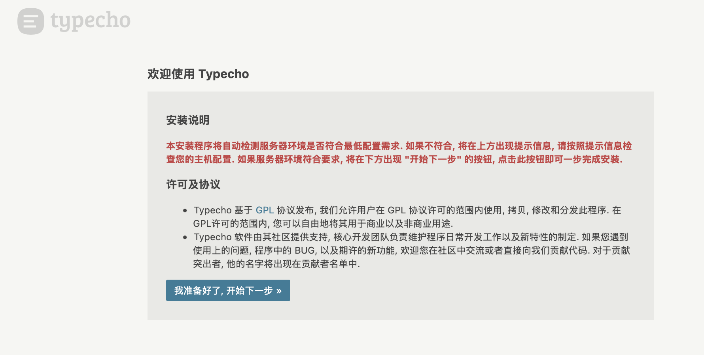
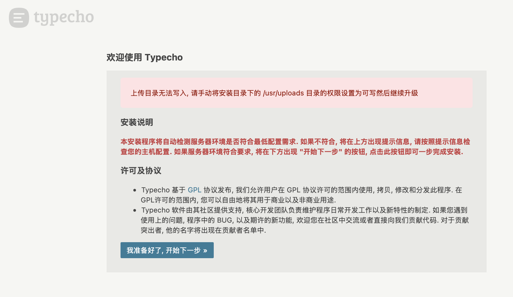
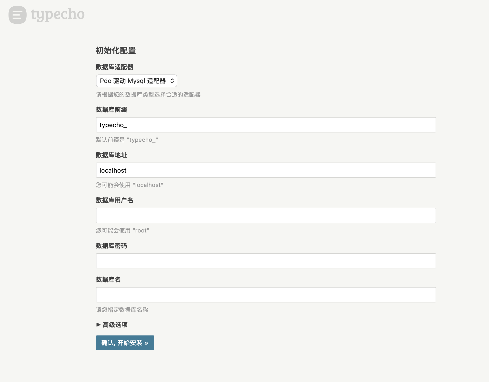
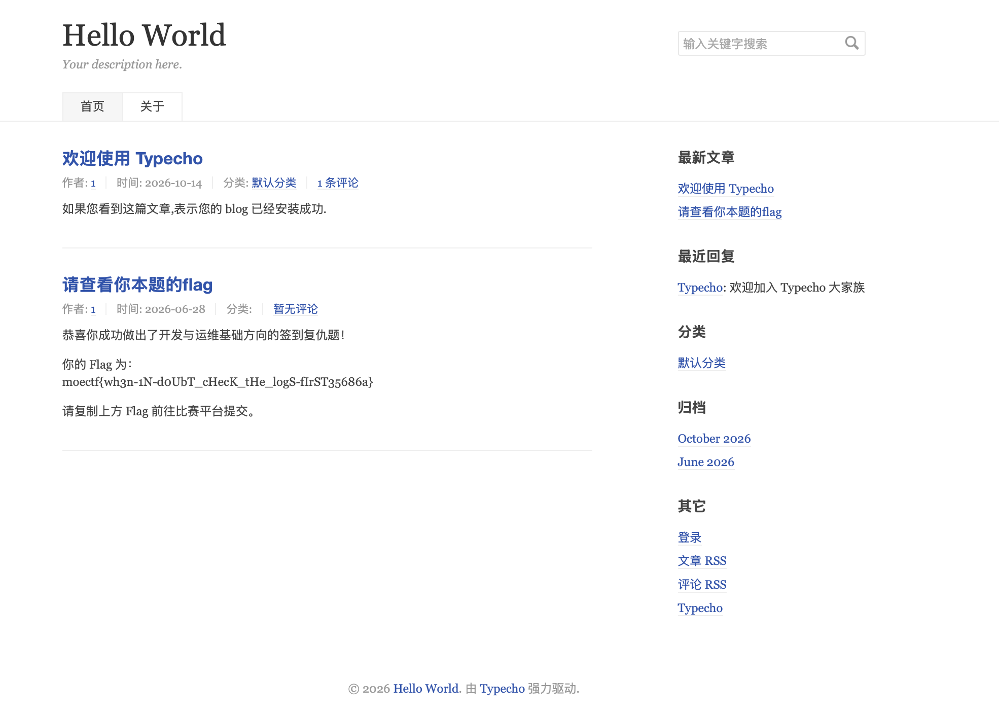

# [运维入门指北_revenge](https://ctf.xidian.edu.cn/games/37/challenges?challenge=1385)
##### 分值：100pts

## 题目描述：
### 原文：
林林跟着入门指北一步步操作，本以为能顺理成章地搭建好属于自己的 Typecho 个人博客。可当启动后，访问页面却总是各种报错。

“明明教程里的每一步指令我都写得清清楚楚啊？怎么跑起来全是坑呢？”

你能帮林林排查一下服务配置和环境问题，修复这个脆弱的博客系统并拿到 Flag 吗？
<hr>
博客网站运维文档：

- SSH：name `moeops`，passwd `foo`
- Nginx 日志地址：`/srv/blog/logs/access.log` & `/srv/blog/logs/error.log`
- 网站文件地址：`/var/www/html/`
- Nginx 配置文件地址：`/etc/nginx/sites-available/blog`
- 数据库配置：
    - 数据库名：`blog`
    - 用户名：`moectf`
    - 密码：`xdsec`
    - 表前缀：`typecho_`
    - 数据库地址：`127.0.0.1`
    - 数据库端口：`3306`
- 服务管理：`sudo systemctl start/restart/status` 服务名


## 分析：
### 网站运维

## 解题步骤：
访问网站：
```html
<html>
<head><title>502 Bad Gateway</title></head>
<body>
<center><h1>502 Bad Gateway</h1></center>
<hr><center>nginx</center>
</body>
</html>
```
啊↘↗上游挂了？
SSH上去，查看错误log：
```sh
cat /srv/blog/logs/error.log
```
```log
2026/10/14 08:27:51 [crit] 303#303: *125 connect() to unix:/run/php/php-fpm.sock failed (2: No such file or directory) while connecting to upstream, client: 127.0.0.1, server: blog.moectf, request: "GET / HTTP/1.1", upstream: "fastcgi://unix:/run/php/php-fpm.sock:", host: "127.0.0.1:8080"
```
```sh
ls /run/php/php-fpm.sock
```
```log
ls: cannot access '/run/php/php-fpm.sock': No such file or directory
```
看来是有配置问题。
```sh
ls /run/php
```
```log
php8.4-fpm.pid  php8.4-fpm.sock
```
看来php活着，是nginx的问题。
修改nginx的配置文件：
```sh
sudo nano /etc/nginx/sites-available/blog
```
~~（为什么没有vim？）~~
```conf
server {
  listen 8080;
  server_name blog.moectf;

  root /var/www/html;
  index index.php;

  location / {
    try_files $uri $uri/ /index.php$is_args$args;
  }

  access_log /srv/blog/logs/access.log;
  error_log /srv/blog/logs/error.log;

  location ~ \.php$ {
    include fastcgi.conf;
    fastcgi_pass unix:/run/php/php8.4-fpm.sock;
    fastcgi_index index.php;
    # fastcgi_param SCRIPT_FILENAME $document_root$fastcgi_script_name;
    include fastcgi_params;
  }
}
```
重启ngnix：
```sh
sudo systemctl restart nginx
```
再次访问网站，可以看到网站已经正常相应了：

点击下一步：

出错了，看起来像权限错误。

再次SSH登录，查看目录信息：（注意：是安装目录下的`/usr/uploads`，不是根目录下的`/usr/uploads`）
```sh
cd /var/www/html/
ls -l
```
```log
total 96
-rw-r--r-- 1 www-data www-data 14974 Jan 20  2026 LICENSE.txt
drwxr-xr-x 5 www-data www-data  4096 Jan 20  2026 admin
-rw-r--r-- 1 www-data www-data   615 Aug 13 03:26 index.nginx-debian.html
-rw-r--r-- 1 www-data www-data   720 Jan 20  2026 index.php
drwxr-xr-x 2 www-data www-data  4096 Jan 20  2026 install
-rw-r--r-- 1 www-data www-data 51045 Jan 20  2026 install.php
drwx------ 1 root     root      4096 Jan 20  2026 usr
drwxr-xr-x 6 www-data www-data  4096 Jan 20  2026 var
```
usr的所有者不对，修改一下：
```sh
sudo chown -R www-data:www-data usr
```
回到网站，现在可以下一步了：

填写信息，完成初始化。

完成后，进入blog：

得到flag。
## Flag
moectf{wh3n-1N-d0UbT_cHecK_tHe_logS-fIrST35686a}