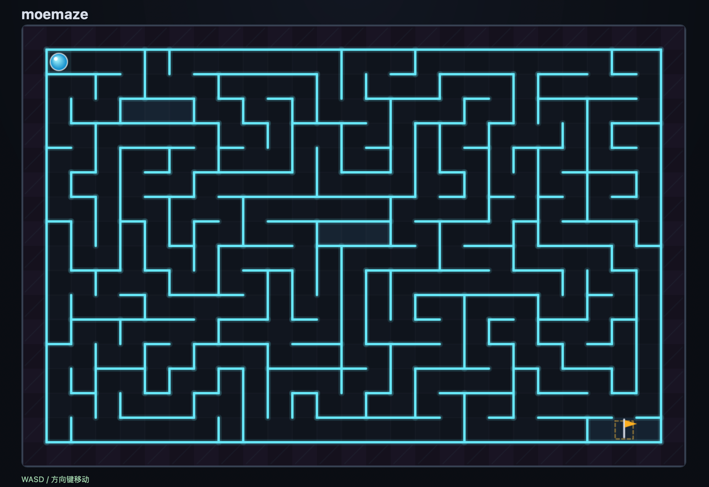
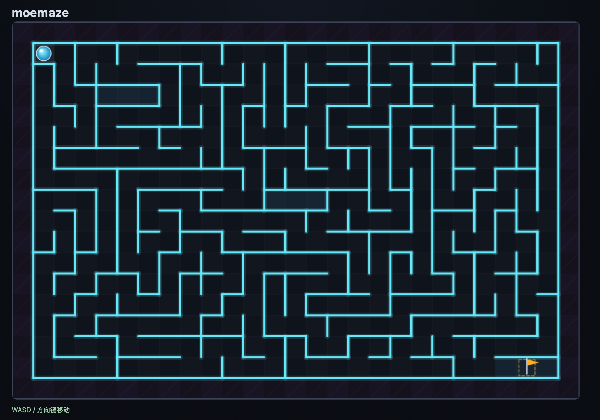
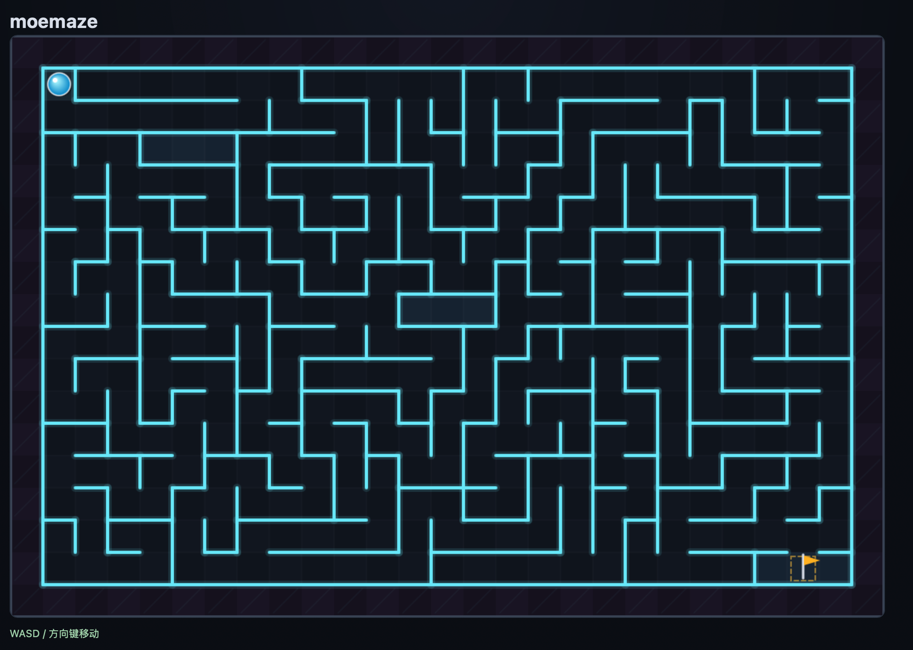
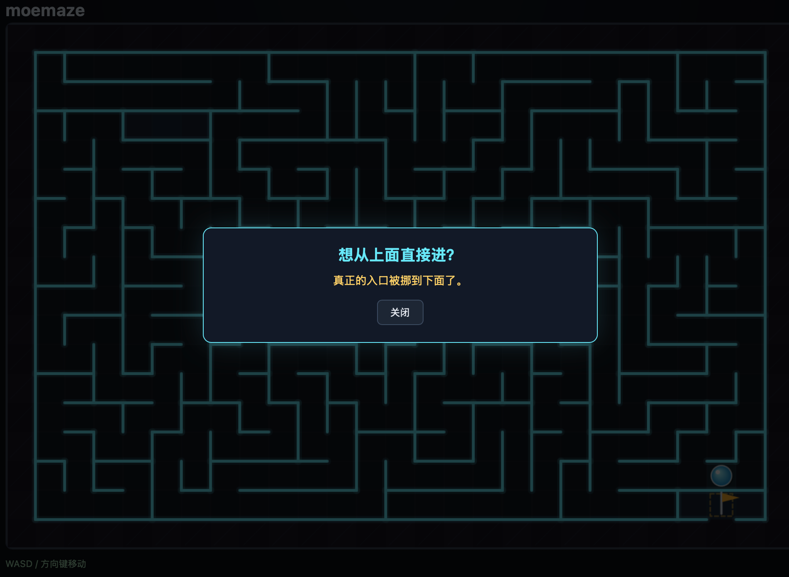
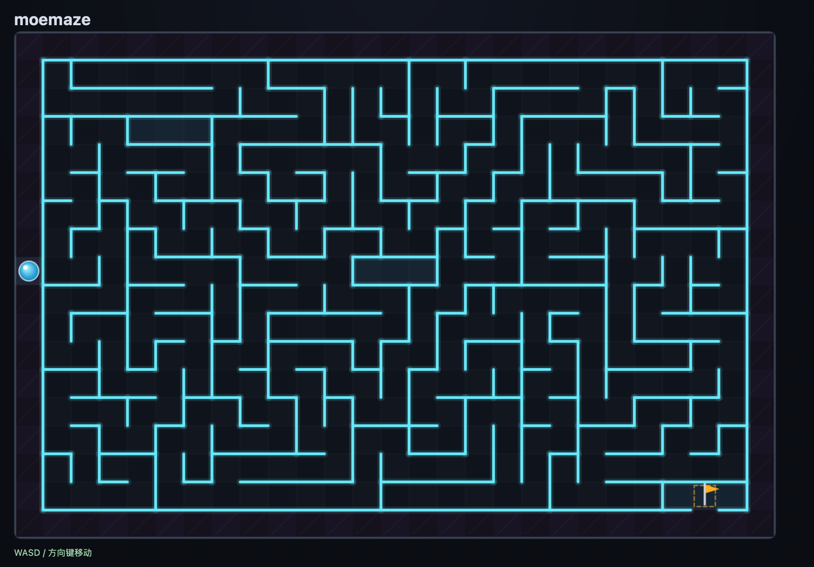
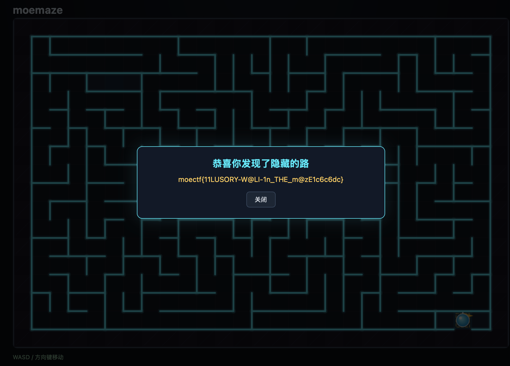

# [Name](https://ctf.xidian.edu.cn/games/37/challenges?challenge=1452)
##### 分值：200pts

## 题目描述：
### 原文：
不可能的迷宫？还是说并非不可能？或许你需要从wasm中寻找线索

## 分析：
### 软件逆向工程？~~（穷举）~~

## 解题步骤：
第一关：
走迷宫.

第二关：
走迷宫..

第三关：
走迷宫...


墙被堵了？！

查看网页的源码，看到`main.js:232`：
```js
  async function submitPath() {
    if (submitting) return;
    submitting = true;
    try {
      const resp = await fetch('/api/claim', {
        method: 'POST',
        headers: { 'Content-Type': 'application/json' },
        body: JSON.stringify({ seed, path }),
      });
      const data = await resp.json();
      if (data.ok) {
        showModal('恭喜你发现了隐藏的路', data.flag || '(ok)');
        statusEl.textContent = 'WASD / 方向键移动';
      } else {
        showModal('验证失败', data.error || 'unknown');
        statusEl.textContent = 'WASD / 方向键移动';
      }
    } catch (e) {
      showModal('提交错误', e.message);
    } finally {
      submitting = false;
    }
  }
```
有隐藏的路？
蹭一遍整张图**所有**的墙，然后：

出来了！

到达终点！
~~（其实本来看了一下wasm的，但是好累，不想看了...）~~
## Flag
moectf{11LUSORY-W@LI-1n_THE_m@zE1c6c6dc}