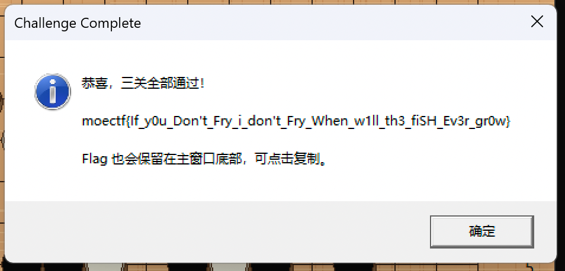

# [神之泥肘](https://ctf.xidian.edu.cn/games/37/challenges?challenge=1446)
##### 分值：100pts

## 题目描述：
### 原文：
“你听懂我在说了吗我们换句话说，如果俞晓暘这一步下在这儿，你就输了😎”

“那他不是没下在这吗，还是我赢了😜”

一花一叶一菩提👽轮回皆是场迷😈我待菩提落满地😡取这半世烟雨🥶削发为僧披袈裟🐑只求我佛渡她😜放下执念与牵挂🤓安坐菩提树下🎉我信这生死轮回😂也愿信我佛慈悲😎尔等岂能体会🤯相思成疾的滋味😇爱别离的感悟🥰菩提树下的参悟😓我愿为你放下全部😊此生让我来渡😮红色彼岸花😊花瓣遍地撒😣谁会在乎她在哭泣啊🥺佛前跪千年🤯未见佛生怜💀我好想能再见她一面😥我跨过忘川😎也走过彼岸😊期盼她还能够回头看🥺忘川河难渡😤挡了她一路😊佛若不渡那就由我来渡😜

## 分析：
### 围棋？

## 解题步骤：
穷举...

## Flag
（见图）~~（当时没有保存文本，现在也不想复现了...）~~