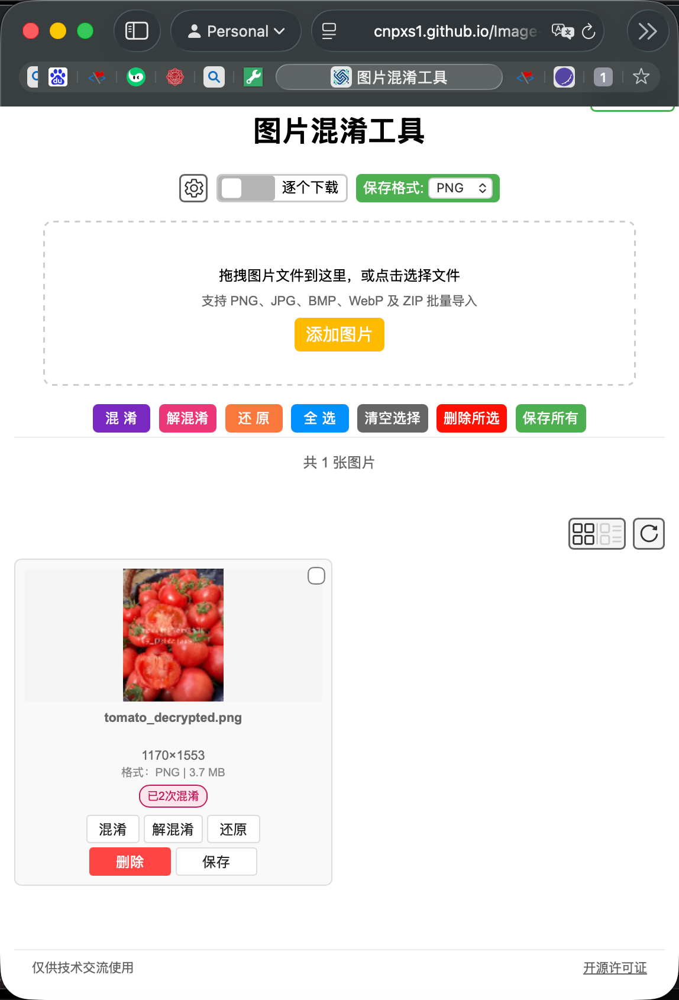
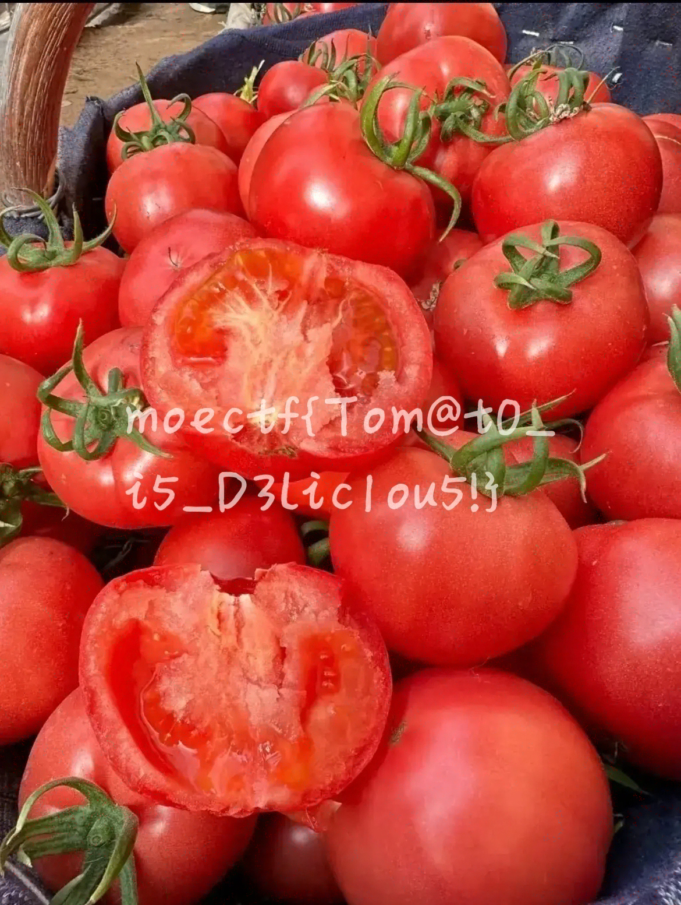

# [Tomato](https://ctf.xidian.edu.cn/games/37/challenges?challenge=1431)
##### 分值：50pts

## 题目描述：
### 原文：
番茄真的很好吃，可是，我的番茄怎么怪怪的

## 分析：
### 图片混淆

## 解题步骤：
使用图片混淆工具处理即可：

## Flag
moectf{Tom@t0_i5_D3lic1ou5!}