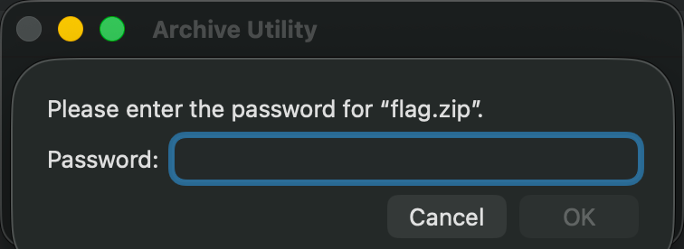

# [一线生机](https://ctf.xidian.edu.cn/games/37/challenges?challenge=1285)
##### 分值：100pts

## 题目描述：
### 原文：
有时候，一线生机往往藏在最明显的地方

## 分析：
### ZipCrypto已知明文攻击

## 解题步骤：
下载flag.zip，尝试打开：

有密码...
执行命令：
```sh
7zz l -slt flag.zip
```
```ini
7-Zip (z) 26.02 (arm64) : Copyright (c) 1999-2026 Igor Pavlov : 2026-06-25
 64-bit arm_v:8.5-A locale=UTF-8 Threads:10 OPEN_MAX:4864, ASM

Scanning the drive for archives:
1 file, 388 bytes (1 KiB)

Listing archive: flag.zip

--
Path = flag.zip
Type = zip
Physical Size = 388

----------
Path = flag.txt
Folder = -
Size = 30
Packed Size = 42
Modified = 2026-07-01 17:21:28.4837045
Created = 2026-07-01 17:21:28.4817141
Accessed = 2026-07-01 17:21:28.4837045
Attributes = A
Encrypted = +
Comment = 
CRC = B5E4F14F
Method = ZipCrypto Store
Characteristics = NTFS : Encrypt Descriptor
Host OS = FAT
Version = 20
Volume Index = 0
Offset = 0

Path = README.md
Folder = -
Size = 54
Packed Size = 66
Modified = 2026-07-01 17:18:29.1985814
Created = 2026-07-01 17:18:29.1960968
Accessed = 2026-07-01 17:18:29.1985814
Attributes = A
Encrypted = +
Comment = 
CRC = B159483A
Method = ZipCrypto Store
Characteristics = NTFS : Encrypt Descriptor
Host OS = FAT
Version = 20
Volume Index = 0
Offset = 80

```
看到文件确实被加密了，但是是`ZipCrypto`！考虑ZipCrypto已知明文攻击。
想到flag.txt的结构固定：moectf{xxx}，但是已知明文攻击需要满足≥12 字节已知明文（其中 ≥8 字节连续），而这些不够...
看到还有一个叫做`README.md`的文件，大小为54B，然后：`有时候，一线生机往往藏在最明显的地方`正好54B！猜测这个`README.md`就是题目描述。
```sh
bkcrack -C flag.zip -c README.md -p README
```
```log
bkcrack 1.8.1 - 2025-10-25
[15:17:53] Z reduction using 47 bytes of known plaintext
100.0 % (47 / 47)
[15:17:53] Attack on 168584 Z values at index 6
Keys: 39cd809b 10a0fcb2 669a68f7
80.3 % (135293 / 168584)
Found a solution. Stopping.
You may resume the attack with the option: --continue-attack 135293
[15:19:17] Keys
39cd809b 10a0fcb2 669a68f7
```
```sh
bkcrack -C flag.zip -c flag.txt -k 39cd809b 10a0fcb2 669a68f7 -d flag.txt
```
```log
bkcrack 1.8.1 - 2025-10-25
[15:20:55] Writing deciphered data flag.txt
Wrote deciphered data (not compressed).
```
```sh
cat flag.txt
```
```log
moectf{1t_i5_So0o0o0o_Obv1ou5}%
```
（%是因为没有`\n`就直接`EOF`了）
## Flag
moectf{1t_i5_So0o0o0o_Obv1ou5}