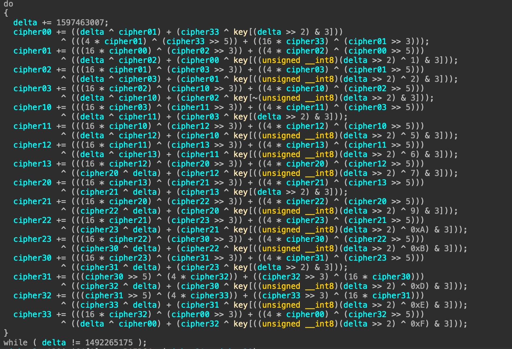
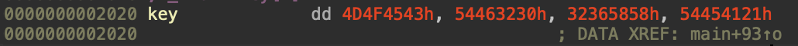
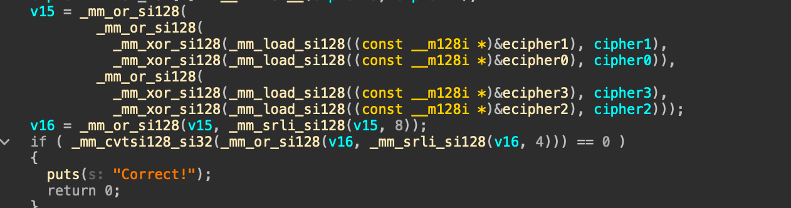
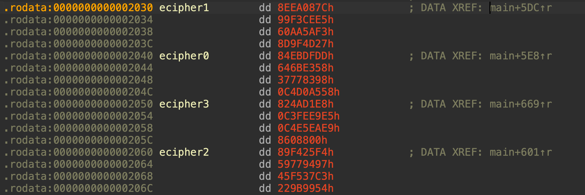

# [请 fanchai 喝茶](https://ctf.xidian.edu.cn/games/37/challenges?challenge=1425)
##### 分值：200pts

## 题目描述：
### 原文：你请 fanchai 喝茶！这次轮到你自己来写解密脚本了，祝你解题顺利。

## 分析：
### 加密逆向

## 解题步骤：
IDA：

判断出为XTEA；提取key：

往下看：

判断出为使用了SIMD加速了的cipher cmp；提取cipher：（注意：cipher的内存排布是128bit线性的，转64bit需要修改符号顺序！）（由于之前我已经用过cipher这个符号了，故改成ecipher）

至此，可以写decrypt函数了：
```c
#include <stdio.h>
#include <stdint.h>
int main() {
    uint32_t cipher[4][4] = {
        {
            0x84EBDFDD, 0x646BE358, 0x37778398, 0xC4D0A558
        },
        {
            0x8EEA087C, 0x99F3CEE5, 0x60AA5AF3, 0x8D9F4D27
        },
        {
            0x89F425F4, 0x59779497, 0x45F537C3, 0x229B9954
        },
        {
            0x824AD1E8, 0xC3FEE9E5, 0xC4E5EAE9, 0x8608800
        }
    };
    const uint32_t key[4] = {
        0x4D4F4543, 0x54463230, 0x32365858, 0x54454121
    };

    uint32_t delta = 1492265175;

    do
    {
        cipher[3][3] -= (((16 * cipher[3][2]) ^ (cipher[0][0] >> 3)) + ((4 * cipher[0][0]) ^ (cipher[3][2] >> 5)))
              ^ ((delta ^ cipher[0][0]) + (cipher[3][2] ^ key[((uint8_t)(delta >> 2) ^ 0xF) & 3]));
        cipher[3][2] -= (((cipher[3][1] >> 5) ^ (4 * cipher[3][3])) + ((cipher[3][3] >> 3) ^ (16 * cipher[3][1])))
              ^ ((cipher[3][3] ^ delta) + (cipher[3][1] ^ key[((uint8_t)(delta >> 2) ^ 0xE) & 3]));
        cipher[3][1] -= (((cipher[3][0] >> 5) ^ (4 * cipher[3][2])) + ((cipher[3][2] >> 3) ^ (16 * cipher[3][0])))
              ^ ((cipher[3][2] ^ delta) + (cipher[3][0] ^ key[((uint8_t)(delta >> 2) ^ 0xD) & 3]));
        cipher[3][0] -= (((16 * cipher[2][3]) ^ (cipher[3][1] >> 3)) + ((4 * cipher[3][1]) ^ (cipher[2][3] >> 5)))
              ^ ((cipher[3][1] ^ delta) + (cipher[2][3] ^ key[(delta >> 2) & 3]));
        cipher[2][3] -= (((16 * cipher[2][2]) ^ (cipher[3][0] >> 3)) + ((4 * cipher[3][0]) ^ (cipher[2][2] >> 5)))
              ^ ((cipher[3][0] ^ delta) + (cipher[2][2] ^ key[((uint8_t)(delta >> 2) ^ 0xB) & 3]));
        cipher[2][2] -= (((16 * cipher[2][1]) ^ (cipher[2][3] >> 3)) + ((4 * cipher[2][3]) ^ (cipher[2][1] >> 5)))
              ^ ((cipher[2][3] ^ delta) + (cipher[2][1] ^ key[((uint8_t)(delta >> 2) ^ 0xA) & 3]));
        cipher[2][1] -= (((16 * cipher[2][0]) ^ (cipher[2][2] >> 3)) + ((4 * cipher[2][2]) ^ (cipher[2][0] >> 5)))
              ^ ((cipher[2][2] ^ delta) + (cipher[2][0] ^ key[((uint8_t)(delta >> 2) ^ 9) & 3]));
        cipher[2][0] -= (((16 * cipher[1][3]) ^ (cipher[2][1] >> 3)) + ((4 * cipher[2][1]) ^ (cipher[1][3] >> 5)))
              ^ ((cipher[2][1] ^ delta) + (cipher[1][3] ^ key[(delta >> 2) & 3]));
        cipher[1][3] -= (((16 * cipher[1][2]) ^ (cipher[2][0] >> 3)) + ((4 * cipher[2][0]) ^ (cipher[1][2] >> 5)))
              ^ ((cipher[2][0] ^ delta) + (cipher[1][2] ^ key[((uint8_t)(delta >> 2) ^ 7) & 3]));
        cipher[1][2] -= (((16 * cipher[1][1]) ^ (cipher[1][3] >> 3)) + ((4 * cipher[1][3]) ^ (cipher[1][1] >> 5)))
              ^ ((delta ^ cipher[1][3]) + (cipher[1][1] ^ key[((uint8_t)(delta >> 2) ^ 6) & 3]));
        cipher[1][1] -= (((16 * cipher[1][0]) ^ (cipher[1][2] >> 3)) + ((4 * cipher[1][2]) ^ (cipher[1][0] >> 5)))
              ^ ((delta ^ cipher[1][2]) + (cipher[1][0] ^ key[((uint8_t)(delta >> 2) ^ 5) & 3]));
        cipher[1][0] -= (((16 * cipher[0][3]) ^ (cipher[1][1] >> 3)) + ((4 * cipher[1][1]) ^ (cipher[0][3] >> 5)))
              ^ ((delta ^ cipher[1][1]) + (cipher[0][3] ^ key[(delta >> 2) & 3]));
        cipher[0][3] -= (((16 * cipher[0][2]) ^ (cipher[1][0] >> 3)) + ((4 * cipher[1][0]) ^ (cipher[0][2] >> 5)))
              ^ ((delta ^ cipher[1][0]) + (cipher[0][2] ^ key[~(uint8_t)(delta >> 2) & 3]));
        cipher[0][2] -= (((16 * cipher[0][1]) ^ (cipher[0][3] >> 3)) + ((4 * cipher[0][3]) ^ (cipher[0][1] >> 5)))
              ^ ((delta ^ cipher[0][3]) + (cipher[0][1] ^ key[((uint8_t)(delta >> 2) ^ 2) & 3]));
        cipher[0][1] -= (((16 * cipher[0][0]) ^ (cipher[0][2] >> 3)) + ((4 * cipher[0][2]) ^ (cipher[0][0] >> 5)))
              ^ ((delta ^ cipher[0][2]) + (cipher[0][0] ^ key[((uint8_t)(delta >> 2) ^ 1) & 3]));
        cipher[0][0] -= ((delta ^ cipher[0][1]) + (cipher[3][3] ^ key[(delta >> 2) & 3]))
              ^ (((4 * cipher[0][1]) ^ (cipher[3][3] >> 5)) + ((16 * cipher[3][3]) ^ (cipher[0][1] >> 3)));
        delta -= 1597463007;
    } while (delta != 0);
    puts((char*)&cipher);
    
}
```

## Flag
moectf{Tre4t_f4ncha1_W1tH_xxtea_Wh4t_A_g00d_Id3a_HahaHAh4hAH4ha}