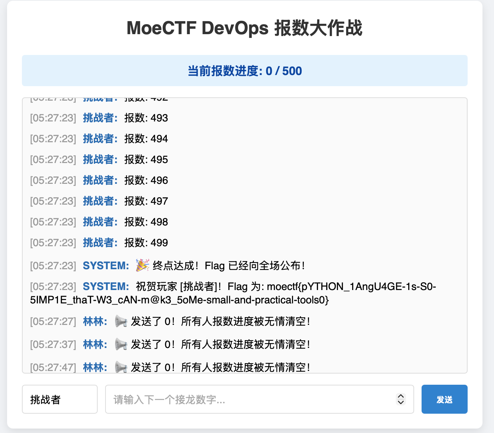

```sh
ssh -p 12346 challenger@127.0.0.1
```
```log
challenger@127.0.0.1's password: moectf2026
Linux ret2shell-1273-24682-1791350660 6.12.94+deb13-amd64 #1 SMP PREEMPT_DYNAMIC Debian 6.12.94-1 (2026-06-20) x86_64

The programs included with the Debian GNU/Linux system are free software;
the exact distribution terms for each program are described in the
individual files in /usr/share/doc/*/copyright.

Debian GNU/Linux comes with ABSOLUTELY NO WARRANTY, to the extent
permitted by applicable law.
/var/tmp/.p failed: exit code 2
Last login: Wed Oct  7 05:25:57 2026 from 127.0.0.1
Python 3.11.15 (main, Jun 24 2026, 02:08:39) [GCC 12.2.0] on linux
Type "help", "copyright", "credits" or "license" for more information.
```
```python
>>> import os
>>> os.system("bash")
```
```sh
challenger@ret2shell-1273-24682-1791350660:~$ vi
bash: vi: command not found
challenger@ret2shell-1273-24682-1791350660:~$ nano
bash: nano: command not found
challenger@ret2shell-1273-24682-1791350660:~$ cat - > a.py
```
```python
import requests

url = "http://127.0.0.1:8080/chat"

for i in range(1, 501):
    r = requests.post(url, json={"user": "挑战者", "msg": i})
    print(f"[{i}] {r.status_code} {r.text[:80]}")

^C
challenger@ret2shell-1273-24682-1791350660:~$ cat a.py
import requests

url = "http://127.0.0.1:8080/chat"

for i in range(1, 501):
    r = requests.post(url, json={"user": "挑战者", "msg": i})
    print(f"[{i}] {r.status_code} {r.text[:80]}")

challenger@ret2shell-1273-24682-1791350660:~$ python3 a.py
```
```log
[1] 200 {"status":"success"}
[2] 200 {"status":"success"}
[3] 200 {"status":"success"}
[4] 200 {"status":"success"}
[5] 200 {"status":"success"}
[6] 200 {"status":"success"}
[7] 200 {"status":"success"}
[8] 200 {"status":"success"}
[9] 200 {"status":"success"}
[10] 200 {"status":"success"}
[11] 200 {"status":"success"}
[12] 200 {"status":"success"}
[13] 200 {"status":"success"}
[14] 200 {"status":"success"}
[15] 200 {"status":"success"}
[16] 200 {"status":"success"}
[17] 200 {"status":"success"}
[18] 200 {"status":"success"}
[19] 200 {"status":"success"}
[20] 200 {"status":"success"}
[21] 200 {"status":"success"}
[22] 200 {"status":"success"}
[23] 200 {"status":"success"}
[24] 200 {"status":"success"}
[25] 200 {"status":"success"}
[26] 200 {"status":"success"}
[27] 200 {"status":"success"}
[28] 200 {"status":"success"}
[29] 200 {"status":"success"}
[30] 200 {"status":"success"}
[31] 200 {"status":"success"}
[32] 200 {"status":"success"}
[33] 200 {"status":"success"}
[34] 200 {"status":"success"}
[35] 200 {"status":"success"}
[36] 200 {"status":"success"}
[37] 200 {"status":"success"}
[38] 200 {"status":"success"}
[39] 200 {"status":"success"}
[40] 200 {"status":"success"}
[41] 200 {"status":"success"}
[42] 200 {"status":"success"}
[43] 200 {"status":"success"}
[44] 200 {"status":"success"}
[45] 200 {"status":"success"}
[46] 200 {"status":"success"}
[47] 200 {"status":"success"}
[48] 200 {"status":"success"}
[49] 200 {"status":"success"}
[50] 200 {"status":"success"}
[51] 200 {"status":"success"}
[52] 200 {"status":"success"}
[53] 200 {"status":"success"}
[54] 200 {"status":"success"}
[55] 200 {"status":"success"}
[56] 200 {"status":"success"}
[57] 200 {"status":"success"}
[58] 200 {"status":"success"}
[59] 200 {"status":"success"}
[60] 200 {"status":"success"}
[61] 200 {"status":"success"}
[62] 200 {"status":"success"}
[63] 200 {"status":"success"}
[64] 200 {"status":"success"}
[65] 200 {"status":"success"}
[66] 200 {"status":"success"}
[67] 200 {"status":"success"}
[68] 200 {"status":"success"}
[69] 200 {"status":"success"}
[70] 200 {"status":"success"}
[71] 200 {"status":"success"}
[72] 200 {"status":"success"}
[73] 200 {"status":"success"}
[74] 200 {"status":"success"}
[75] 200 {"status":"success"}
[76] 200 {"status":"success"}
[77] 200 {"status":"success"}
[78] 200 {"status":"success"}
[79] 200 {"status":"success"}
[80] 200 {"status":"success"}
[81] 200 {"status":"success"}
[82] 200 {"status":"success"}
[83] 200 {"status":"success"}
[84] 200 {"status":"success"}
[85] 200 {"status":"success"}
[86] 200 {"status":"success"}
[87] 200 {"status":"success"}
[88] 200 {"status":"success"}
[89] 200 {"status":"success"}
[90] 200 {"status":"success"}
[91] 200 {"status":"success"}
[92] 200 {"status":"success"}
[93] 200 {"status":"success"}
[94] 200 {"status":"success"}
[95] 200 {"status":"success"}
[96] 200 {"status":"success"}
[97] 200 {"status":"success"}
[98] 200 {"status":"success"}
[99] 200 {"status":"success"}
[100] 200 {"status":"success"}
[101] 200 {"status":"success"}
[102] 200 {"status":"success"}
[103] 200 {"status":"success"}
[104] 200 {"status":"success"}
[105] 200 {"status":"success"}
[106] 200 {"status":"success"}
[107] 200 {"status":"success"}
[108] 200 {"status":"success"}
[109] 200 {"status":"success"}
[110] 200 {"status":"success"}
[111] 200 {"status":"success"}
[112] 200 {"status":"success"}
[113] 200 {"status":"success"}
[114] 200 {"status":"success"}
[115] 200 {"status":"success"}
[116] 200 {"status":"success"}
[117] 200 {"status":"success"}
[118] 200 {"status":"success"}
[119] 200 {"status":"success"}
[120] 200 {"status":"success"}
[121] 200 {"status":"success"}
[122] 200 {"status":"success"}
[123] 200 {"status":"success"}
[124] 200 {"status":"success"}
[125] 200 {"status":"success"}
[126] 200 {"status":"success"}
[127] 200 {"status":"success"}
[128] 200 {"status":"success"}
[129] 200 {"status":"success"}
[130] 200 {"status":"success"}
[131] 200 {"status":"success"}
[132] 200 {"status":"success"}
[133] 200 {"status":"success"}
[134] 200 {"status":"success"}
[135] 200 {"status":"success"}
[136] 200 {"status":"success"}
[137] 200 {"status":"success"}
[138] 200 {"status":"success"}
[139] 200 {"status":"success"}
[140] 200 {"status":"success"}
[141] 200 {"status":"success"}
[142] 200 {"status":"success"}
[143] 200 {"status":"success"}
[144] 200 {"status":"success"}
[145] 200 {"status":"success"}
[146] 200 {"status":"success"}
[147] 200 {"status":"success"}
[148] 200 {"status":"success"}
[149] 200 {"status":"success"}
[150] 200 {"status":"success"}
[151] 200 {"status":"success"}
[152] 200 {"status":"success"}
[153] 200 {"status":"success"}
[154] 200 {"status":"success"}
[155] 200 {"status":"success"}
[156] 200 {"status":"success"}
[157] 200 {"status":"success"}
[158] 200 {"status":"success"}
[159] 200 {"status":"success"}
[160] 200 {"status":"success"}
[161] 200 {"status":"success"}
[162] 200 {"status":"success"}
[163] 200 {"status":"success"}
[164] 200 {"status":"success"}
[165] 200 {"status":"success"}
[166] 200 {"status":"success"}
[167] 200 {"status":"success"}
[168] 200 {"status":"success"}
[169] 200 {"status":"success"}
[170] 200 {"status":"success"}
[171] 200 {"status":"success"}
[172] 200 {"status":"success"}
[173] 200 {"status":"success"}
[174] 200 {"status":"success"}
[175] 200 {"status":"success"}
[176] 200 {"status":"success"}
[177] 200 {"status":"success"}
[178] 200 {"status":"success"}
[179] 200 {"status":"success"}
[180] 200 {"status":"success"}
[181] 200 {"status":"success"}
[182] 200 {"status":"success"}
[183] 200 {"status":"success"}
[184] 200 {"status":"success"}
[185] 200 {"status":"success"}
[186] 200 {"status":"success"}
[187] 200 {"status":"success"}
[188] 200 {"status":"success"}
[189] 200 {"status":"success"}
[190] 200 {"status":"success"}
[191] 200 {"status":"success"}
[192] 200 {"status":"success"}
[193] 200 {"status":"success"}
[194] 200 {"status":"success"}
[195] 200 {"status":"success"}
[196] 200 {"status":"success"}
[197] 200 {"status":"success"}
[198] 200 {"status":"success"}
[199] 200 {"status":"success"}
[200] 200 {"status":"success"}
[201] 200 {"status":"success"}
[202] 200 {"status":"success"}
[203] 200 {"status":"success"}
[204] 200 {"status":"success"}
[205] 200 {"status":"success"}
[206] 200 {"status":"success"}
[207] 200 {"status":"success"}
[208] 200 {"status":"success"}
[209] 200 {"status":"success"}
[210] 200 {"status":"success"}
[211] 200 {"status":"success"}
[212] 200 {"status":"success"}
[213] 200 {"status":"success"}
[214] 200 {"status":"success"}
[215] 200 {"status":"success"}
[216] 200 {"status":"success"}
[217] 200 {"status":"success"}
[218] 200 {"status":"success"}
[219] 200 {"status":"success"}
[220] 200 {"status":"success"}
[221] 200 {"status":"success"}
[222] 200 {"status":"success"}
[223] 200 {"status":"success"}
[224] 200 {"status":"success"}
[225] 200 {"status":"success"}
[226] 200 {"status":"success"}
[227] 200 {"status":"success"}
[228] 200 {"status":"success"}
[229] 200 {"status":"success"}
[230] 200 {"status":"success"}
[231] 200 {"status":"success"}
[232] 200 {"status":"success"}
[233] 200 {"status":"success"}
[234] 200 {"status":"success"}
[235] 200 {"status":"success"}
[236] 200 {"status":"success"}
[237] 200 {"status":"success"}
[238] 200 {"status":"success"}
[239] 200 {"status":"success"}
[240] 200 {"status":"success"}
[241] 200 {"status":"success"}
[242] 200 {"status":"success"}
[243] 200 {"status":"success"}
[244] 200 {"status":"success"}
[245] 200 {"status":"success"}
[246] 200 {"status":"success"}
[247] 200 {"status":"success"}
[248] 200 {"status":"success"}
[249] 200 {"status":"success"}
[250] 200 {"status":"success"}
[251] 200 {"status":"success"}
[252] 200 {"status":"success"}
[253] 200 {"status":"success"}
[254] 200 {"status":"success"}
[255] 200 {"status":"success"}
[256] 200 {"status":"success"}
[257] 200 {"status":"success"}
[258] 200 {"status":"success"}
[259] 200 {"status":"success"}
[260] 200 {"status":"success"}
[261] 200 {"status":"success"}
[262] 200 {"status":"success"}
[263] 200 {"status":"success"}
[264] 200 {"status":"success"}
[265] 200 {"status":"success"}
[266] 200 {"status":"success"}
[267] 200 {"status":"success"}
[268] 200 {"status":"success"}
[269] 200 {"status":"success"}
[270] 200 {"status":"success"}
[271] 200 {"status":"success"}
[272] 200 {"status":"success"}
[273] 200 {"status":"success"}
[274] 200 {"status":"success"}
[275] 200 {"status":"success"}
[276] 200 {"status":"success"}
[277] 200 {"status":"success"}
[278] 200 {"status":"success"}
[279] 200 {"status":"success"}
[280] 200 {"status":"success"}
[281] 200 {"status":"success"}
[282] 200 {"status":"success"}
[283] 200 {"status":"success"}
[284] 200 {"status":"success"}
[285] 200 {"status":"success"}
[286] 200 {"status":"success"}
[287] 200 {"status":"success"}
[288] 200 {"status":"success"}
[289] 200 {"status":"success"}
[290] 200 {"status":"success"}
[291] 200 {"status":"success"}
[292] 200 {"status":"success"}
[293] 200 {"status":"success"}
[294] 200 {"status":"success"}
[295] 200 {"status":"success"}
[296] 200 {"status":"success"}
[297] 200 {"status":"success"}
[298] 200 {"status":"success"}
[299] 200 {"status":"success"}
[300] 200 {"status":"success"}
[301] 200 {"status":"success"}
[302] 200 {"status":"success"}
[303] 200 {"status":"success"}
[304] 200 {"status":"success"}
[305] 200 {"status":"success"}
[306] 200 {"status":"success"}
[307] 200 {"status":"success"}
[308] 200 {"status":"success"}
[309] 200 {"status":"success"}
[310] 200 {"status":"success"}
[311] 200 {"status":"success"}
[312] 200 {"status":"success"}
[313] 200 {"status":"success"}
[314] 200 {"status":"success"}
[315] 200 {"status":"success"}
[316] 200 {"status":"success"}
[317] 200 {"status":"success"}
[318] 200 {"status":"success"}
[319] 200 {"status":"success"}
[320] 200 {"status":"success"}
[321] 200 {"status":"success"}
[322] 200 {"status":"success"}
[323] 200 {"status":"success"}
[324] 200 {"status":"success"}
[325] 200 {"status":"success"}
[326] 200 {"status":"success"}
[327] 200 {"status":"success"}
[328] 200 {"status":"success"}
[329] 200 {"status":"success"}
[330] 200 {"status":"success"}
[331] 200 {"status":"success"}
[332] 200 {"status":"success"}
[333] 200 {"status":"success"}
[334] 200 {"status":"success"}
[335] 200 {"status":"success"}
[336] 200 {"status":"success"}
[337] 200 {"status":"success"}
[338] 200 {"status":"success"}
[339] 200 {"status":"success"}
[340] 200 {"status":"success"}
[341] 200 {"status":"success"}
[342] 200 {"status":"success"}
[343] 200 {"status":"success"}
[344] 200 {"status":"success"}
[345] 200 {"status":"success"}
[346] 200 {"status":"success"}
[347] 200 {"status":"success"}
[348] 200 {"status":"success"}
[349] 200 {"status":"success"}
[350] 200 {"status":"success"}
[351] 200 {"status":"success"}
[352] 200 {"status":"success"}
[353] 200 {"status":"success"}
[354] 200 {"status":"success"}
[355] 200 {"status":"success"}
[356] 200 {"status":"success"}
[357] 200 {"status":"success"}
[358] 200 {"status":"success"}
[359] 200 {"status":"success"}
[360] 200 {"status":"success"}
[361] 200 {"status":"success"}
[362] 200 {"status":"success"}
[363] 200 {"status":"success"}
[364] 200 {"status":"success"}
[365] 200 {"status":"success"}
[366] 200 {"status":"success"}
[367] 200 {"status":"success"}
[368] 200 {"status":"success"}
[369] 200 {"status":"success"}
[370] 200 {"status":"success"}
[371] 200 {"status":"success"}
[372] 200 {"status":"success"}
[373] 200 {"status":"success"}
[374] 200 {"status":"success"}
[375] 200 {"status":"success"}
[376] 200 {"status":"success"}
[377] 200 {"status":"success"}
[378] 200 {"status":"success"}
[379] 200 {"status":"success"}
[380] 200 {"status":"success"}
[381] 200 {"status":"success"}
[382] 200 {"status":"success"}
[383] 200 {"status":"success"}
[384] 200 {"status":"success"}
[385] 200 {"status":"success"}
[386] 200 {"status":"success"}
[387] 200 {"status":"success"}
[388] 200 {"status":"success"}
[389] 200 {"status":"success"}
[390] 200 {"status":"success"}
[391] 200 {"status":"success"}
[392] 200 {"status":"success"}
[393] 200 {"status":"success"}
[394] 200 {"status":"success"}
[395] 200 {"status":"success"}
[396] 200 {"status":"success"}
[397] 200 {"status":"success"}
[398] 200 {"status":"success"}
[399] 200 {"status":"success"}
[400] 200 {"status":"success"}
[401] 200 {"status":"success"}
[402] 200 {"status":"success"}
[403] 200 {"status":"success"}
[404] 200 {"status":"success"}
[405] 200 {"status":"success"}
[406] 200 {"status":"success"}
[407] 200 {"status":"success"}
[408] 200 {"status":"success"}
[409] 200 {"status":"success"}
[410] 200 {"status":"success"}
[411] 200 {"status":"success"}
[412] 200 {"status":"success"}
[413] 200 {"status":"success"}
[414] 200 {"status":"success"}
[415] 200 {"status":"success"}
[416] 200 {"status":"success"}
[417] 200 {"status":"success"}
[418] 200 {"status":"success"}
[419] 200 {"status":"success"}
[420] 200 {"status":"success"}
[421] 200 {"status":"success"}
[422] 200 {"status":"success"}
[423] 200 {"status":"success"}
[424] 200 {"status":"success"}
[425] 200 {"status":"success"}
[426] 200 {"status":"success"}
[427] 200 {"status":"success"}
[428] 200 {"status":"success"}
[429] 200 {"status":"success"}
[430] 200 {"status":"success"}
[431] 200 {"status":"success"}
[432] 200 {"status":"success"}
[433] 200 {"status":"success"}
[434] 200 {"status":"success"}
[435] 200 {"status":"success"}
[436] 200 {"status":"success"}
[437] 200 {"status":"success"}
[438] 200 {"status":"success"}
[439] 200 {"status":"success"}
[440] 200 {"status":"success"}
[441] 200 {"status":"success"}
[442] 200 {"status":"success"}
[443] 200 {"status":"success"}
[444] 200 {"status":"success"}
[445] 200 {"status":"success"}
[446] 200 {"status":"success"}
[447] 200 {"status":"success"}
[448] 200 {"status":"success"}
[449] 200 {"status":"success"}
[450] 200 {"status":"success"}
[451] 200 {"status":"success"}
[452] 200 {"status":"success"}
[453] 200 {"status":"success"}
[454] 200 {"status":"success"}
[455] 200 {"status":"success"}
[456] 200 {"status":"success"}
[457] 200 {"status":"success"}
[458] 200 {"status":"success"}
[459] 200 {"status":"success"}
[460] 200 {"status":"success"}
[461] 200 {"status":"success"}
[462] 200 {"status":"success"}
[463] 200 {"status":"success"}
[464] 200 {"status":"success"}
[465] 200 {"status":"success"}
[466] 200 {"status":"success"}
[467] 200 {"status":"success"}
[468] 200 {"status":"success"}
[469] 200 {"status":"success"}
[470] 200 {"status":"success"}
[471] 200 {"status":"success"}
[472] 200 {"status":"success"}
[473] 200 {"status":"success"}
[474] 200 {"status":"success"}
[475] 200 {"status":"success"}
[476] 200 {"status":"success"}
[477] 200 {"status":"success"}
[478] 200 {"status":"success"}
[479] 200 {"status":"success"}
[480] 200 {"status":"success"}
[481] 200 {"status":"success"}
[482] 200 {"status":"success"}
[483] 200 {"status":"success"}
[484] 200 {"status":"success"}
[485] 200 {"status":"success"}
[486] 200 {"status":"success"}
[487] 200 {"status":"success"}
[488] 200 {"status":"success"}
[489] 200 {"status":"success"}
[490] 200 {"status":"success"}
[491] 200 {"status":"success"}
[492] 200 {"status":"success"}
[493] 200 {"status":"success"}
[494] 200 {"status":"success"}
[495] 200 {"status":"success"}
[496] 200 {"status":"success"}
[497] 200 {"status":"success"}
[498] 200 {"status":"success"}
[499] 200 {"status":"success"}
[500] 200 {"status":"win"}
```

# Flag
moectf{pYTHON_1AngU4GE-1s-S0-5IMP1E_thaT-W3_cAN-m@k3_5oMe-small-and-practical-tools0}